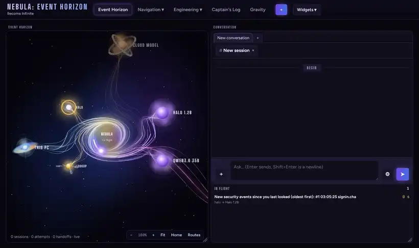
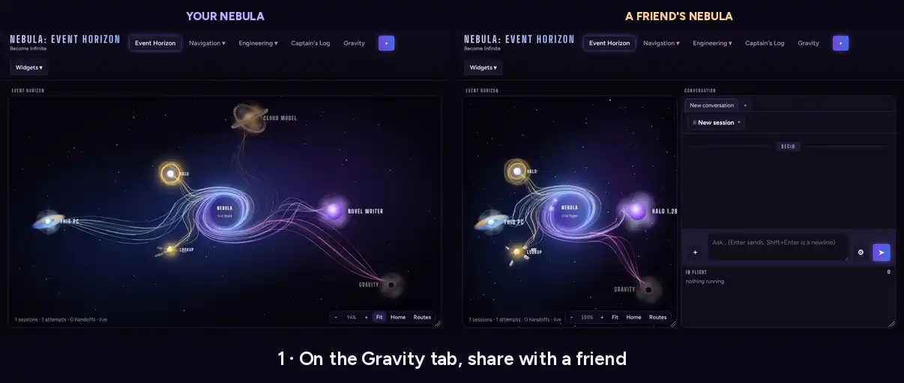
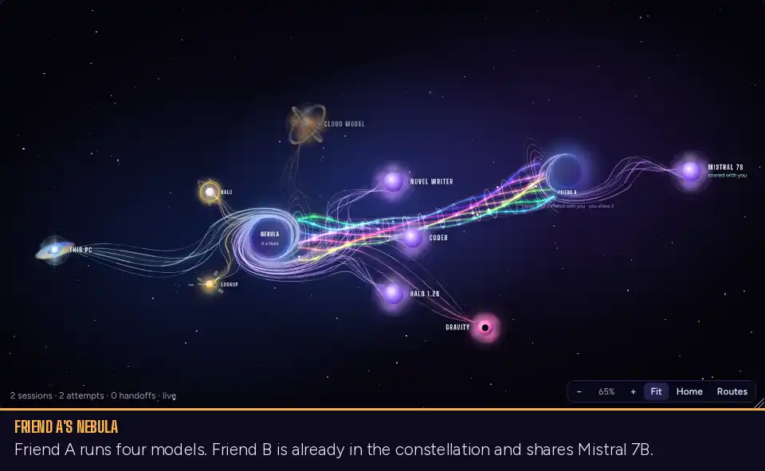

# Nebula: Event Horizon

**Deploy your own local AI on your own computer. Secure it, share it, scale it with friends, only if you want to.**

**Nebula: Event Horizon** (Nebula EH for short, or just Nebula) is a desktop app that puts AI models on your graphics card for you. You don't need to know what a
"server" or a "quantization" is. You open Nebula, pick a model from a short list we've tested, and start chatting.
Everything runs on your machine, and nothing leaves it unless you say so.

**Deploy your own and join us.**



> **Nebula is in testing.** Things may be rough around the edges. If something goes wrong, tell us (see [Getting help](#getting-help)). That's the whole point of testing.

**New in 0.2.0: your models as a team, skills and a toolbox.** With **Star Weaving** on, the model Halo picks for a
task leads it: it can hand parts to the rest of your models, ask one of them, move the work up to a larger model, and
send it for review before you get one answer back. **Skills** (folders with a SKILL.md, from a link or a skills
repository) teach your models a job, and the **toolbox** lets a model work on files and run commands in one folder,
inside a sandbox. The page is rearranged: the tabs are now **Navigation**, **Captain's Log**, **Engineering** and
**Control** (see below). An older NVIDIA card can now work beside a newer one on **Impulse (L)**, and Halo can run
Liquid AI's **LFM3-Omni** if you pick it. The details are in the [changelog](CHANGELOG.md).

---

## Built for two things: easy and private

### Easy

- **No setup knowledge needed.** No terminals after install, no config files, no jargon. Nebula picks sensible
  settings for your graphics card.
- **Tested models, sized for you.** You choose from a short list we've tried ourselves, not thousands of files.
- **Guided steps for everything.** Adding a model, sharing with a friend or indexing a folder is a wizard with plain
  words, a summary before anything happens, and **Undo** after.
- **Cancel really cancels.** Backing out of a wizard changes nothing.
- **One download, one install.** A small installer brings the rest itself: Nebula, the Impulse engine, Halo's own
  model, Lookup and its document reading. No administrator, nothing to compile. Anything optional (Impulse portable
  for a computer without an NVIDIA card, Impulse's Flash-Next engine) downloads only when you need it, and Nebula
  says what it is, how big, and why before it does.

### Private

Your AI runs on **your** computer. Your chats, your documents and your history stay there.

- **No account, no sign-up, no tracking.** Nebula doesn't phone home. It sends no usage data, no analytics and no
  crash reports. It doesn't even look for updates unless you ask it to.
- **Your conversations stay local.** The Captain's Log, Halo's chats and Lookup's index all live in files on your
  machine.
- **Your documents never go to the cloud.** Lookup reads and searches them on your computer.
- **Locked by default.** A PIN or passkey guards your Nebula, each model runs in a sandbox with no internet access
  (when NVIDIA OpenShell is installed; otherwise Nebula tells you),
  and websites can't send it commands.
- **Nobody can find you.** Nebula never advertises itself on your network or the internet. Friends connect only with
  a one-time invite from you, and they only see the models you tick.

**What does leave your computer**, and only when you do it:

| When | What goes out |
|---|---|
| You install Nebula | Downloads only, each checked against its known fingerprint where its maker publishes one: Python, Nebula's packages (from PyPI), Halo's own model and Lookup's search and document-reading models (from Hugging Face), Lookup's database program (Qdrant), NVIDIA OpenShell, and with an NVIDIA card, CUDA's libraries from NVIDIA. On Windows with the Safe sandbox: Ubuntu for WSL2 and Impulse's Linux build. |
| You download a model | A download from Hugging Face, where the models live. |
| Nebula needs an optional piece | A download from this project's GitHub releases, checked against its pinned fingerprint: Impulse portable (about 25 MB, only on a computer without an NVIDIA card), Impulse's Flash-Next engine (about 105 MB, only when you set up Flash-Next) or Impulse (L) (about 471 MB on Linux, 586 MB on Windows, only on a computer whose NVIDIA cards are all older ones: GTX 900 / 10 series, Titan X / Xp / V, Tesla M / P / V100). Nebula tells you first. |
| You look for an update | One request to GitHub for a small signed file that names the newest version. Only when you press **Look now**, or once at start-up if you turned that on. The update itself downloads only when you click it. |
| You turn on web search | Your search words, to Brave Search or DuckDuckGo. |
| You add a cloud model (Anti-Gravity) | Whatever you send that model, to the company that runs it. Nebula marks these clearly. |
| You share with a friend (Gravity) | Their requests and your model's answers, encrypted. They go directly on your home network, otherwise through a relay you run yourself, or through iroh's free public relays if you switch that on. A relay only passes along traffic it can't read. |

That's the whole list. If none of these are on, Nebula works with no internet at all.

---

## What you need

- A computer running **Linux** (we test on Ubuntu 22.04 and 24.04), or **Windows 10** (21H2 or LTSC 2021 or later)
  or **Windows 11**, 64-bit Intel or AMD.
- An **NVIDIA graphics card** with its driver installed. We test on the RTX 30, 40 and 50 series. Impulse is also
  built for the RTX 20 series and data center cards like the A100 and H100, but we test those less. Older cards (GTX 900
  and 10 series, Titan X / Xp / V, Tesla M, P and V100) run on **Impulse (L)**, an optional download Nebula offers on such
  a computer (driver 525.60.13 or newer; 528.33 on Windows). 8 GB of video
  memory runs the light model, 12 GB the all-rounder and 16 GB the biggest. **Flint**, the coding model, runs on 8 GB
  and up when the computer has RAM free for its experts: about 27 GB for Q4, 38 GB for Q6 at its 32K context (two cards that hold all of Q4
  write about twice as fast).
- **No NVIDIA card? An AMD Radeon or another card works too, more slowly.** Nebula then runs models on Impulse
  portable (a small download, about 25 MB, the first time it needs it) through Vulkan: as much of the model as fits on
  the card, the rest in RAM, and on the CPU when no card answers through Vulkan. Run a model says beforehand how much
  goes on the card. These models run directly on your computer, not in a sandbox (a sandbox does not reach the
  graphics card). Qwen3.8 Flash-Next needs an NVIDIA card. We have tested a Radeon RX 5500M (4 GB); other cards are
  untested.
- **An internet connection** while you install and while you download your first model.
- About 5 GB of disk space for Nebula itself, and more for models. They are big: a typical one is 5 to 20 GB.
- On Linux, `curl` or `wget` (most Linux desktops have one; if not: `sudo apt install curl`).
- **For the sandbox on Linux (optional):** Docker or Podman, so each model runs in its own NVIDIA OpenShell sandbox.
  The installer tells you the command if it is missing; without it, models run outside a sandbox and Nebula says so.
- **For the sandbox on Windows:** virtualization switched on in your computer's BIOS. Setup does the rest.

**Not yet:** Macs.

## Install

**On Linux:**

1. Download **`nebula-eh-0.1.7-linux-x86_64.run`** (about 243 MB) from the [Releases page](../../releases).
2. Open a terminal in the folder where it downloaded and run:

   ```bash
   sh nebula-eh-0.1.7-linux-x86_64.run
   ```

   You don't need `sudo`. Nebula installs just for you, in your home folder. It fetches the rest as it goes (Python,
   its packages, Halo's model, Lookup's models, OpenShell) and tells you each step; it takes a few minutes. If
   something needs your computer's administrator (Docker, the NVIDIA driver), it says exactly what to run.
3. Nebula opens by itself. Next time, open **Nebula EH** from your app menu.

**On Windows:**

1. Download **`Nebula-EH-Setup-0.1.7.exe`** (about 225 MB) from the [Releases page](../../releases).
2. Double-click it. It installs just for you and fetches the rest as it goes; it takes a few minutes.
3. Setup asks **"Run your models in a Safe sandbox?"** Say **Yes** (it's the default). Each model then runs in its
   own container inside its own small Linux (Ubuntu 24.04 under WSL2), just like on Linux. If WSL2 isn't on yet,
   Windows asks for an administrator once and may need one restart; the sandbox then finishes by itself the next time
   you sign in. It downloads about 350 MB (Ubuntu plus Impulse's Linux build).
4. Open **Nebula EH** from the Start menu or the desktop icon.

Uninstalling Nebula also removes its sandbox. WSL itself, your models and your settings stay.

That's it.

## Your first five minutes

1. **Make a PIN or a passkey.** The first time Nebula opens, it asks you to pick a PIN (4 to 12 digits) or use a
   passkey (your fingerprint, face, phone or security key). This keeps other people, and websites, from using
   your Nebula.
2. **Get your first model.** Nebula shows a short list of models we've tested, sized for your graphics card. Each
   one says whether it is **everyday** (quick, light) or **larger** (smarter, slower, needs more memory), and
   whether it is **Standard** or **Uncensored** (Standard is picked for you unless you change it). Pick one and
   press go. Nebula downloads it and starts it on the
   Impulse engine.
3. **Say hello.** Nebula sends a test message to make sure everything works, then you're in. Click
   **Halo** to chat.

If you change your mind about anything a wizard did, there's an **Undo**. Pressing **Cancel** changes nothing.

## Finding your way around

Nebula draws your setup as a little space map. Everything on it is something you can click.

| On the map | What it is |
|---|---|
| **The black hole** | Your Nebula, in the middle. It glows amber when your graphics card runs hot (red when very hot); hover for each card. Right-click it for the quick menu, including any models you've hidden. |
| **Model stars** | The AI models you've set up. |
| **Halo** (the star with rings) | Where you chat. Its ring is a guard that watches for trouble and is on by default (see below). You can rename it. |
| **Lookup** (the **Dyson Sphere**, a swarm of silver satellites) | Lets Halo read your own documents and search the web. |
| **API Server** (the **Quasars**) | Doors for other apps on your computer or home network to use your models. |
| **Gravity** | The door to friends' Nebulas, over the internet. Off until you turn it on. |
| **Anti-Gravity** (stars in chains) | Cloud models like the ones you pay a company for. Optional. They're chained because they can never be shared. |
| **Friends' systems** | Each friend you've joined, with their models round them. Ones they share with you are free, with a route. Ones they don't are chained. |

**Mouse basics:** drag to move things, scroll to zoom, right-click a star for its menu.

Along the top are the tabs. **Event Horizon** is the map; the others open a row of pages:

| Tab | Page | What's in it |
|---|---|---|
| **Navigation** | **Star Calling** | Smart routing: which models answer which kind of request (your routes), and who's asking (your apps, your friends). |
| | **Star Weaving** | Teamwork: your models as teams, Halo's questions, the missions under way. |
| | **Gravity** | **Constellation** on top (the gateway: your own machines and how friends reach you), then **Gravity** (your friends, what each one may use, Block). |
| **Captain's Log** | | Every conversation and every choice Nebula made, to look back on, plus the error log, OpenTelemetry and syslog. |
| **Engineering** | **Engines** | Your machines and the engines that run the models. |
| | **Models** | The model files (get, load, delete), cloud models, and each model's toolbox. |
| | **Skills** | Find, add, turn on and update skills. |
| **Control** | **Halo** | Halo's personality, instructions, version and Lookup. |
| | **Appearance** | The look of the map: animations and effects. |
| | **System** | Updates, apps and phones, sign-in and sandboxes. |

Most panels on a page are widgets: drag the corner to resize one, fold it, move it, or put it back.

### Traffic control

At the heart of Nebula is its traffic control, the event horizon every message passes through. When a message comes
in, Nebula picks which model answers, keeps a queue when a model is busy, and writes every conversation and choice in
the **Captain's Log**, so you can look back at what happened. You steer it from **Navigation → Star Calling** and
tune your engines in **Engineering**.

**Smart routing** (Star Calling) is a switch and a choice of how it decides:

- **Off**: every request goes down **Any task**, the first route, its models in your order.
- **Just watch**: Halo picks each request's route but only writes its pick down (on each reply's "why?"), so you see
  what it would do first.
- **Halo picks**: **Halo** reads each message and sends it down a route: **everyday** (quick questions and chat),
  **larger** (code, analysis, step-by-step work), **writing** (stories, scenes, poems) or **critique** (feedback on
  your writing). Every reply says which model answered and why.
- **Save power**, **Balanced** or **Best answers**: no Halo call; Nebula scores each request (a long prompt, pictures,
  code, tool errors, asked again) and sends the hard ones to a larger model. **Custom** sets the numbers yourself.

You choose which models are on each route, and in what order, and you can add routes of your own (**+ Add a new
route**). Cloud models are only used when you ask for one by name.

### Star Weaving: your models as a team

With **Teamwork** on, the model Halo picks for a task leads it. It may hand parts of the work to its team, ask a
teammate a question, hand the work up to a larger model, and send the result for review; you get one answer back,
with a line saying who did what. Halo referees: it refuses a hand-off to a model that is down, too small for the
work, or past the task's limits, and it asks you when a team has a question only you can answer.

- **Off by default.** Off, Halo gives every task to one model, the way Star Calling says.
- **Teams and contracts.** Halo suggests teams from your models (accept or decline them); each team has a contract:
  who leads, who helps, who reviews, what "done" means and the limits it works to.
- **Limits** for every task: how many teammates at once, how deep the work may be handed down, tokens, time (20
  minutes while you wait in a chat, 2 hours in the background), rework rounds, and the most it may spend on cloud
  models (US $1 to start). A task stops at its limit and tells you.
- **Only yours.** Teamwork, skills and the toolbox are never offered to a friend, a guest or another Nebula using your
  models.
- Ask Halo in the chat ("Halo, I want to do this task") and it starts a team task; **Star Weaving** shows the missions
  under way and the ones done.

### Skills

A skill is a folder with a SKILL.md: instructions (and sometimes scripts) that teach a model a job. **Engineering →
Skills** adds one from a link (a GitHub folder or any SKILL.md) or finds one in a skills repository, checks it first
and says what it asks to run, and keeps it up to date. A skill is used only once you turn it on, and Nebula loads it
only for a task it fits. Its scripts run in a sandbox, never on your computer directly. A skill the check warns about
comes in switched off.

### The toolbox

A model with the toolbox works in **one folder** you pick (**Engineering → Models**, per model): it lists, searches,
reads, writes and patches files there, and runs commands (your tests, say) inside an OpenShell sandbox with no
network. Nothing outside the folder is reachable, and without OpenShell it can't run commands at all. Every file it
touches and every command it runs is in the Captain's Log.

### Halo

**Halo** is where you chat. (That's its name out of the box; you can change it.) Its rings keep watch when you
share your models:

- a soft **glow** means all is calm,
- a **pulse** means it's looking at something,
- **orange** means trouble is brewing,
- **red** means it stepped in (like slowing down a guest who was misbehaving) or wants to ask you.

It only takes small steps that you can undo with one button. Anything bigger, it asks you first. It never touches
your own use.

Halo thinks with a small model of its own, on your graphics card (or the CPU): Liquid AI's **LFM3-1.7B** with an
NVIDIA card, **LFM2.5-1.2B** without one, each with Nebula's adapters for its jobs (the guard, the router, and the
briefing a model gets when a conversation moves to another one). It is downloaded once, the one your computer runs,
and its licence (LFM Open License v1.0) comes with Nebula. You can also let Halo think with the Assistant's model,
or, with an NVIDIA card, pick **Omni** (Liquid AI's LFM3-Omni-2B, in **Control → Halo → Version**): the model (about
1 GB, from Liquid AI) and Nebula's adapters for it (about 30 MB) download the first time you pick it.

### Lookup

Give Lookup a folder (**+ → New Lookup collection**) and Halo can search your documents and tell you which
file and page each answer came from. Your documents stay on your computer. Lookup can also do web searches, if you
switch that on.

### Using Nebula from other apps

Most AI apps can talk to Nebula instead of a cloud service. Click the **API Server** to copy the address (for apps
on this computer it's `http://localhost:8090/v1`). It works with apps that speak the OpenAI, Anthropic or Ollama
style. To reach it from a phone or TV on your home network, add an entry point there. Each one gets its own key.

## Sharing with friends (Gravity)

This is the "join us" part.

> **Gravity is still in testing.** It works, and it's encrypted end to end, but it has had far less real-world use
> than the rest of Nebula. Share with people you trust while we shake it out.



When you're ready:

1. Open **Navigation → Gravity** and choose **Share with a friend**.
2. Tick the models your friend may use.
3. Send them the one-time invite. It works once, then expires.

Good to know:

- **A friend gets nothing until you tick it.** They can see the names of your models, but only the ones you
  ticked are usable. The rest show up chained on their map. They never see your chats, files or settings.
- **You choose per friend.** Each friend gets their own ticks, so you can share a model with one friend and not
  another.
- **Invites are one to one.** Each invite joins one friend to you. If two of your friends want to share with each
  other, one of them invites the other.
- **Nobody finds you by accident.** Nebula never advertises itself. Only someone with your invite can connect.
- **Cloud models are never shared.** They're on your bill and your account, so their tick is greyed out.
- Some models come with a warning (for example, one Nebula can't lock down). You can still share them, but you're
  asked to confirm, and your friend sees the warning too.



You can also join your own machines this way, like a second PC with a spare graphics card, and run them all from
one Nebula.

## Local, isolated, containerized

Those three words are how Nebula is built.

**Local.** Your models run on your own graphics cards. Your chats, your documents, your settings and your keys are
files on your own computer. Once a model is downloaded, Nebula works with the internet unplugged.

**Isolated.** Every model runs in its own locked box (where a box isn't possible, Nebula tells you; see
[Safe by default](#safe-by-default)), and the box gets nothing it doesn't need:

- no network at all, so a model can't send anything anywhere,
- the system and the model files are read-only, so it can't change them,
- one small scratch folder of its own, and it never runs as the administrator (root).

People are kept apart too. Each friend gets their own key and their own ticks, sees only what you ticked, and never
sees your chats, files or settings. Cloud models never leave your account.

**Containerized.** Each box is a container, run by NVIDIA OpenShell with Docker or Podman (on Windows, Podman inside
Nebula's own small Linux under WSL2). Impulse's container is
built on your computer from the Impulse that came with Nebula, llama.cpp's comes from its makers' official image, and
any engine you already have as a container image runs the same way. Stopping a model deletes its box. **Add a
server** puts the same boxes on your other computers.

## Safe by default

You don't have to set any of this up. It's already on.

- **Sign-in:** a PIN or passkey protects your Nebula's page.
- **Sandboxed engines:** Nebula runs each model inside a locked box (NVIDIA OpenShell) with no internet access and
  read-only files. If OpenShell isn't on your computer, the model still runs, and Nebula shows you a warning. If you
  share that model, your friend sees the warning too.
- **Models on your other computers.** **Add a server** puts another Linux computer with NVIDIA cards to work for your
  Nebula: it sets up only what runs models there (no second Nebula), asks for that computer's password once in the
  page for the parts that need an administrator, and then its cards show up in **Engines** next to your own. Its
  models run in the same locked boxes, and everything between the two computers is encrypted.
- **Any engine in a box.** Besides Impulse, Nebula can run llama.cpp's own engine, or any engine you have in a
  container image, the same protected way.
- **No key needed on this computer.** Apps on your own PC can use your models straight away. On your home network,
  Nebula strongly encourages a key and warns you if you skip it.
- **Websites can't drive it.** Nebula only takes commands from its own page.
- **Safe updates.** Before an update changes your saved settings or history, Nebula makes a backup copy.

Where it's less locked down, Nebula tells you, and here it is in one place:

- **No sandbox on Linux without Docker or Podman, or on Windows if you said No** (or a setup step failed). The model
  still runs, as a normal program on your computer, with a warning in Nebula (and on your friend's side if you share
  it). **Control → System** says why.
- **Models on an AMD Radeon or another non-NVIDIA card run without a sandbox**, directly on your computer, because a
  sandbox can't reach that graphics card. Run a model's preview says so before you start.
- **On Windows, the container is the whole sandbox.** Models are read-only to it and its port is reachable from this
  PC only, but OpenShell's network rules don't run on Windows yet, so the "no network at all" rule isn't enforced
  there.
- **Your home network uses plain HTTP**, like Ollama does. A key per device stops strangers using it, but anyone on
  your network who can watch the traffic could read it.
- **Friends don't get Impulse's prompt memory.** To keep guests apart, a friend's request on an Impulse model starts
  fresh every time. That's safe, but long conversations from friends are slower than your own.

## Updates

Nebula never updates itself behind your back. In **Control → System → Updates** you pick one of three:

- **Only when I ask** (the default): Nebula never looks until you press **Look now**.
- **Check when Nebula opens**: one look, a minute after it starts, and none after that.
- **Off**: never, and the **Look now** button goes away.

When there is a new version, a small **Update ready** shows at the top. Nebula only believes an update notice that
we signed, and checks every download against its fingerprint. Nothing installs until you click; then Nebula waits for
any reply still on the way, updates, and opens again. (A Nebula you built from source just opens the release page.)

**Small updates, from 0.1.4 on.** When only Nebula's own code changed, the update is a few MB instead of the whole
installer, and the page says which one you'll get and how big it is. Coming from 0.1.3 or earlier, you get the whole
installer once.

## Impulse: one engine

Nebula comes with **Impulse**, our own engine, built in. It is the one engine behind everything Nebula runs: every
tested model, Halo and the big setups below all run on the same Impulse. Before we moved our own setups over to it,
we checked that each one gives exactly the same answers as the engine it replaced.

- **On an NVIDIA card**, the full Impulse that comes in the installer.
- **On any other card, or the CPU alone**, Impulse portable: a smaller build of Impulse that uses Vulkan (or the CPU)
  instead of CUDA, a small download the first time it's needed. Halo runs on Impulse everywhere, Windows included:
  LFM3 on an NVIDIA card (Impulse runs it natively), the previous Halo on Impulse portable until LFM3 runs there.
- **Answers appear as they are written.** The thinking and the answer show word by word, and stopping a reply frees
  the model at once.
- **Flint 40B**, Recursive's coding model, runs on Impulse in two sizes (Q4 and Q6), each also as an uncensored
  build. It runs on an 8 GB card with its experts in your computer's RAM; Nebula says how much RAM before it
  downloads.

**How fast?** On the same graphics card, in our tests, Impulse reads long prompts 2 to 7 times faster than llama.cpp
and writes answers 1.1 to 1.8 times faster. To be fair about it: we ran llama.cpp with its own new expert cache
switched off, so today the gap may be smaller. We haven't re-checked that yet.

**Other engines.** Nebula no longer ships or needs llama.cpp's server, but you can still run it yourself as a
reference from the **Engineering** tab, and any engine you have in a container image works there too.

## Advanced: big setups, CPU and memory

Everything about your computer's CPU and memory (RAM) lives here, because you don't need it for the easy path. These
are for people with a lot of memory and more than one graphics card. They are not in the easy model list.

- **Impulse Flash-Next** runs very large expert models (Qwen3.8 Flash-Next) split across your graphics cards and
  your computer's memory. **It's a guided setup:** **Run a model › Qwen3.8 Flash-Next** asks for a Hugging Face
  repository, checks that it really is a Flash-Next model, shows its sizes and which of them fit this computer, and
  runs it on Impulse in a sandbox. Impulse's Flash-Next engine is a separate download (about 105 MB), fetched only
  when you set one up, and the setup tells you first. A Flash-Next pack you already have on disk works too
  (**Advanced**).
  - **What it needs:** Linux with Docker or Podman, an NVIDIA card (it won't run on other cards, and says so), a CPU
    with AVX2 (AVX-512 makes it faster), and a lot of RAM: the experts stay in RAM, so the bigger the size you pick,
    the more it takes. The setup marks the sizes that don't fit.
  - **What we run it on:** two NVIDIA RTX 50 series cards (12 GB and 16 GB) and two server CPUs. That gives about
    100 tokens a second writing and about 2,000 a second reading. Smaller machines haven't been tried.
- **Long context** (Flash-Next only) is an opt-in, **off by default**. In **Engineering**, a Flash-Next model can be set to
  512K or 1M tokens instead of 262K. Nebula only stretches the model once a conversation grows past 262K, and it found
  hidden test words at every length we tried up to 1M. It costs some speed on every request, even short ones. In our
  tests, 512K read about 5% slower and wrote 1% to 8% slower; 1M read about 25% slower and wrote about 15% slower.
  Answers under 262K stay effectively the same, but not bit-for-bit, because the bigger memory leaves a smaller expert
  cache and a little more work moves to the CPU.
- **Several requests at once** (Flash-Next) is an opt-in, **off by default** (one at a time). You can turn on up to 8 at once.
  Honestly: in our tests two at once gave less total speed than one at a time (10% to 15% less), and the answers aren't
  yet bit-for-bit the same as one at a time. Each extra slot also takes video memory from the expert cache.
- **Several slots on the regular models.** Impulse's **Parallel slots** setting works, but when several requests (or
  one request with drafting) land together, part of each step skips the graphics card's expert cache and runs on the
  CPU. More slots can end up slower. We haven't measured by how much yet.

## Known limits

We'd rather you hear it from us:

- **NVIDIA cards get the most testing.** AMD Radeon and other cards run through Vulkan: they're slower, run
  without a sandbox, and we've tested only one Radeon so far. Qwen3.8 Flash-Next needs NVIDIA. Mac isn't supported.
- **In the code, but switched off and never tried between two real computers:** sending expert work to another
  computer over the network, splitting one model's layers across two computers, and the fast RDMA network link.
  They're there for the future; Nebula doesn't use them.
- **Teamwork, skills and the toolbox are new.** Teams use the models on this computer and your own machines, not a
  friend's (that may come later). The toolbox runs commands only where OpenShell is set up. A skill's check warns; it
  doesn't prove a skill safe, so add skills from people you trust.
- **Impulse (L) hasn't run on a real older card yet.** It is built and checked for every card from Maxwell to
  Blackwell; tell us how it goes on yours.
- **Tested models only, out of the box.** The short list is what we've checked. You can add other GGUF models
  yourself, but we haven't tried them.

## Getting help

- Something broke? Open **Captain's Log**. Its error log can be copied.
- Tell us in an [issue](../../issues), with what you did and what you saw. A screenshot helps.

## For developers

Building from source, the config file, the full API and how the pieces fit together are in
[docs/DEVELOPING.md](docs/DEVELOPING.md) and the rest of [docs/](docs/).

## Licence

MIT, see [LICENSE](LICENSE). Nebula and Impulse include code from other open-source projects, each under its own
licence; see [NOTICE](NOTICE).

## Buy me some compute

Nebula is free and open source, and it always will be. If it's useful to you, you can buy me some compute.

<p align="center"><a href="https://buymeacoffee.com/thed1c"></a></p>
